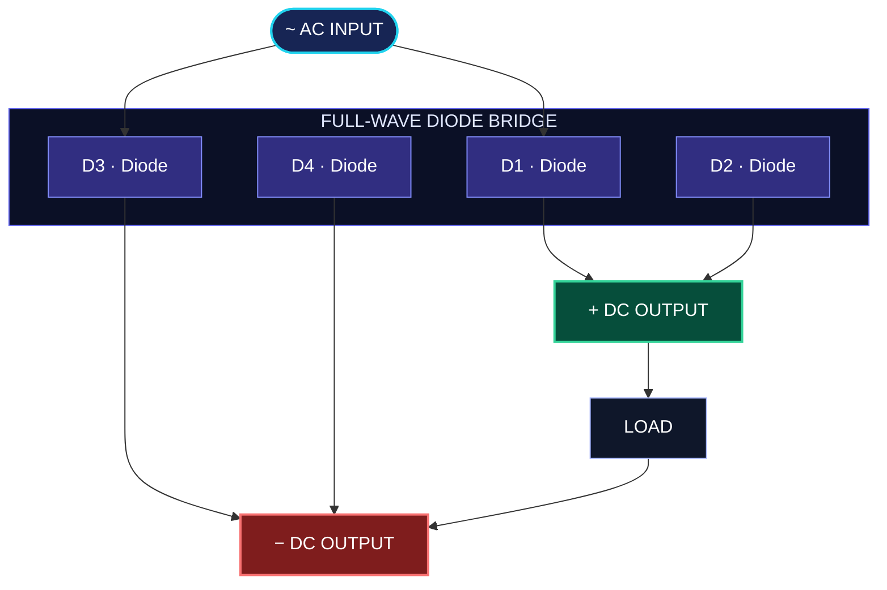
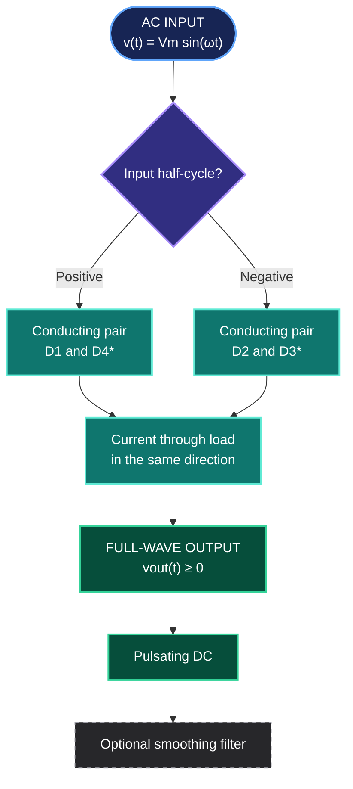
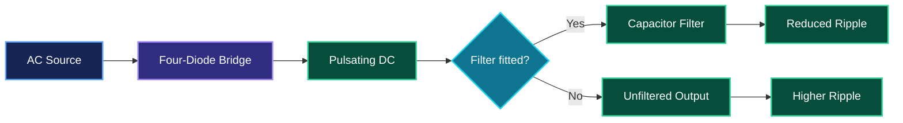

 

 

### ⚡ Converting Alternating Current into Direct Current

*A bridge rectifier circuit designed to explore semiconductor conduction, full-wave rectification, and practical printed circuit board engineering.*

 

---

### `CIRCUIT VISUALIZATION // FULL-WAVE RECTIFICATION`

**AC INPUT → DIODE BRIDGE → DC OUTPUT**

MIDNIGHT BLUE · ELECTRIC CYAN · VIOLET

 

# PROJECT ABSTRACT

### Design, Analysis & Implementation of a Full-Wave Bridge Rectifier PCB

 

---

<strong>▸ ABSTRACT — Engineering Overview</strong>

 

This project presents the **design, electrical analysis, and printed circuit board (PCB) implementation of a Full-Wave Bridge Rectifier**, a fundamental building block in power electronics and AC-to-DC conversion systems.

The primary objective is to develop a compact, structured, and practical electronic circuit capable of converting an alternating-current (AC) input into a unidirectional pulsating direct-current (DC) output. The design employs a **four-diode bridge configuration**, utilizing both half-cycles of the input waveform to achieve full-wave rectification.

The project integrates circuit theory, semiconductor diode characteristics, electrical calculations, schematic development, PCB layout considerations, component selection, and hardware validation. Particular attention is given to diode conduction paths, forward-voltage losses, reverse-voltage stress, current-handling capability, thermal behavior, and the relationship between electrical performance and PCB layout.

The theoretical analysis establishes the expected output waveform and provides a foundation for evaluating average DC voltage, RMS voltage, rectification efficiency, ripple factor, and power dissipation. When a smoothing capacitor is incorporated, further analysis can be conducted to investigate output ripple and load-dependent voltage variations.

The resulting PCB provides a practical engineering platform for studying AC-to-DC conversion and the relationship between theoretical circuit behavior and physical implementation. It also establishes a foundation for future improvements involving enhanced filtering, voltage regulation, thermal optimization, circuit simulation, and experimental performance characterization.

---

### `CORE ENGINEERING CONCEPTS`

 

### `KEYWORDS`

`Power Electronics` · `Full-Wave Rectification` · `Bridge Rectifier` · `Printed Circuit Board` · `AC-to-DC Conversion` · `Semiconductor Diodes` · `Ripple Analysis` · `Circuit Design` · `Hardware Validation`

POWER ELECTRONICS • CIRCUIT ANALYSIS • PCB IMPLEMENTATION

 

  

---

<strong>✦ 02. INTRODUCTION — Background & Engineering Context</strong>

 

### `FROM ALTERNATING CURRENT TO USEFUL DC POWER`

Electrical and electronic systems frequently require a **direct-current (DC) power source**, even when the available energy source provides alternating-current (AC) voltage. This requirement arises in embedded systems, industrial control circuits, instrumentation, electronic interfaces, and power-supply applications.

A rectifier performs the conversion from AC into a unidirectional current. Among the common rectifier topologies, the **full-wave bridge rectifier** is widely used because it utilizes both half-cycles of the AC waveform without requiring a center-tapped transformer.

However, designing a practical rectifier involves more than connecting four diodes. The engineer must consider source voltage, diode ratings, load current, power dissipation, reverse-voltage withstand capability, PCB trace dimensions, terminal placement, and the quality of the resulting DC waveform.

This project addresses these considerations by combining theoretical electrical analysis with PCB-oriented engineering. It progresses from understanding the circuit principle to developing a physical board that can be inspected, assembled, and tested.

Its academic value lies in the opportunity to extend basic rectification into **quantitative performance evaluation, simulation, design optimization, and experimental validation**—making it a useful foundation for advanced engineering work.

---

<strong>✦ 03. PROBLEM STATEMENT — The Engineering Challenge</strong>

 

### `DESIGNING A RELIABLE AC-TO-DC CONVERSION STAGE`

The central engineering question addressed by this project is:

> **How can an AC input be converted into a reliable, unidirectional DC output using a compact PCB while maintaining acceptable electrical losses, component temperatures, and output-waveform quality?**

The investigation focuses on the following engineering challenges:

| ID | Engineering question |
|:--:|---|
|  | How do the four diodes conduct during the positive and negative input half-cycles? |
|  | What output voltage is expected after accounting for diode forward-voltage drops? |
|  | How do diode current and reverse-voltage ratings affect operating limits and safety margins? |
|  | How does PCB layout influence current paths, manufacturability, and reliability? |
|  | How can theoretical behavior be compared with simulated and measured results? |
|  | What modifications are required to obtain smoother, regulated, or higher-current DC output? |

---

<strong>✦ 04. PROJECT OBJECTIVES — Design & Validation Roadmap</strong>

 

### `FROM CIRCUIT THEORY TO PCB IMPLEMENTATION`

**Main objective:** To design and analyze a full-wave bridge rectifier PCB for AC-to-DC conversion, considering its electrical behavior, component selection, and practical implementation requirements.

#### `01 — THEORETICAL ANALYSIS`

- Understand the operating principle of a four-diode bridge rectifier.
- Calculate expected output voltage, current, ripple, and power losses.
- Analyze diode conduction paths and semiconductor voltage drops.

#### `02 — CIRCUIT & PCB DESIGN`

- Develop and verify the electrical schematic.
- Select components according to the intended input voltage and load.
- Create a manufacturable PCB layout.
- Check footprints, polarity, electrical connectivity, and clearances.

#### `03 — TESTING & PERFORMANCE EVALUATION`

- Assemble and inspect the PCB, if fabrication is included.
- Evaluate circuit operation through electrical measurements and waveform analysis.
- Compare theoretical, simulated, and measured results where available.
- Identify limitations and propose technically justified improvements.

  

 

DEFINE THE SYSTEM · UNDERSTAND THE CIRCUIT · QUANTIFY THE PERFORMANCE

---

<strong>✦ 05. SCOPE OF THE PROJECT</strong>

 

### `SYSTEM BOUNDARIES & FUNCTIONAL ARCHITECTURE`

The core of this project is the design and analysis of a **full-wave bridge rectifier PCB**. Its scope focuses on AC-to-DC rectification, semiconductor operation, circuit implementation, and the electrical characteristics of the resulting output.

The circuit is not assumed to be a regulated power supply. Filtering and voltage regulation are treated as optional extensions unless they are explicitly implemented in the actual design.

#### Functional stages

```mermaid
flowchart LR
    A["AC INPUT<br/>Low-voltage source"] --> B["DIODE BRIDGE<br/>Four semiconductors"]
    B --> C["FULL-WAVE<br/>RECTIFICATION"]
    C --> D["PULSATING DC<br/>OUTPUT"]
    D -. "Optional" .-> E["FILTER<br/>Capacitor"]
    E -. "Optional" .-> F["REGULATOR<br/>Voltage control"]

    classDef source fill:#172554,stroke:#60A5FA,color:#FFFFFF,stroke-width:2px
    classDef bridge fill:#312E81,stroke:#A78BFA,color:#FFFFFF,stroke-width:2px
    classDef output fill:#064E3B,stroke:#34D399,color:#FFFFFF,stroke-width:2px
    classDef optional fill:#27272A,stroke:#71717A,color:#E4E4E7,stroke-dasharray:5 5

    class A source
    class B,C bridge
    class D output
    class E,F optional
```

#### Scope definition

| Functional stage | Description | Project status |
|---|---|---|
| AC input | Low-voltage AC source or transformer secondary | Required |
| Four-diode bridge | Converts both AC half-cycles | Core circuit |
| Rectified output | Unidirectional, pulsating DC voltage | Required |
| Capacitor filtering | Reduces output-voltage ripple | Optional |
| Voltage regulation | Maintains a controlled DC output | Optional |

> **Engineering boundary:** The actual PCB schematic determines which stages are present. A filter or regulator must not be claimed as an implemented feature unless it exists in the circuit.

---

<strong>✦ 06. THEORETICAL BACKGROUND & MATHEMATICAL ANALYSIS</strong>

 

### `THE PHYSICS BEHIND FULL-WAVE RECTIFICATION`

### `6.1 — Operating Principle`

A full-wave bridge rectifier consists of four semiconductor diodes connected in a bridge configuration. During each half-cycle of the AC input, a different pair of diodes conducts, maintaining the same polarity across the load.

Consequently, both the positive and negative half-cycles contribute to the rectified output. The output voltage is unidirectional but remains pulsating unless a suitable filtering stage is added.

#### Bridge rectification — functional flow

*The conducting diode pairs depend on the bridge's actual diode labeling and input/output terminal orientation. Confirm the pair names against your schematic.

- the load in the defined output direction.
- Negative half-cycle: the other diagonal pair conducts, maintaining the same current direction through the load.
- Result: both half-cycles contribute to the output, producing a pulsating DC waveform with twice the input frequency.
For a conventional single-phase input, the rectified ripple frequency is therefore twice the AC supply frequency

 

FROM SINUSOIDAL INPUT TO RECTIFIED DC · THEORY MEETS ENGINEERING

---

<strong>✦ 06.2 — IDEAL OUTPUT VOLTAGE</strong>

 

For a sinusoidal AC input, the instantaneous source voltage is defined as

$$
\boxed{v_s(t)=V_m\sin(\omega t)}
$$

where \(V_m\) is the peak input voltage and \(\omega=2\pi f\) is the angular frequency.

For ideal diodes, the full-wave rectified output is

$$
\boxed{v_o(t)=\left|V_m\sin(\omega t)\right|}
$$

The average DC component of the unfiltered output is

$$
V_{DC}=\frac{1}{2\pi}\int_0^{2\pi}|V_m\sin\theta|\,d\theta
$$

$$
\boxed{V_{DC}=\frac{2V_m}{\pi}}
$$

Since \(V_m=\sqrt{2}\,V_{AC,\mathrm{RMS}}\), the average output can also be expressed as

$$
\boxed{V_{DC}\approx0.9003\,V_{AC,\mathrm{RMS}}}
$$

> **Engineering note:** This is the average output of an ideal, unfiltered full-wave rectifier. It is not the peak output voltage of a rectifier with a large smoothing capacitor.

---

### ✦ 06.3 — PRACTICAL OUTPUT VOLTAGE

In a practical bridge rectifier, two diodes conduct in series during each half-cycle. The instantaneous output voltage can be approximated by:

$$
\boxed{v_o(t) \approx \max\left( |v_s(t)| - 2V_F,\ 0 \right)}
$$

where \(V_F\) represents the forward-voltage drop of one conducting diode.

The actual output depends on the diode characteristics, input amplitude, source impedance, load current, and temperature. The constant-drop model is useful for initial calculations but should be verified against datasheets and measurements.

For a resistive load \(R_L\), Ohm's law gives:

$$
\boxed{i_L(t) = \frac{v_o(t)}{R_L}}
$$

The instantaneous power dissipated by the load is:

$$
\boxed{p_L(t) = v_o(t)i_L(t) = \frac{v_o^2(t)}{R_L}}
$$

| **Parameter** | **Symbol** | **Engineering Meaning** |
|:---|:---:|:---|
| Peak input voltage | \(V_m\) | Maximum instantaneous AC input |
| Diode forward drop | \(V_F\) | Voltage drop across one conducting diode |
| Load resistance | \(R_L\) | Resistive output load |
| Load current | \(i_L(t)\) | Instantaneous current through the load |

---

### ✦ 06.4 — RMS VOLTAGE & RECTIFICATION EFFICIENCY

For an ideal, unfiltered, full-wave rectified waveform, the RMS output voltage is:

$$
\boxed{V_{o,\mathrm{RMS}} = \frac{V_m}{\sqrt{2}}}
$$

The ripple factor measures the RMS magnitude of the AC component relative to the DC component:

$$
r = \sqrt{\left(\frac{V_{o,\mathrm{RMS}}}{V_{DC}}\right)^2 - 1}
$$

Substituting the ideal full-wave rectifier expressions gives:

$$
\boxed{r = \sqrt{\frac{\pi^2}{8} - 1} \approx 0.482}
$$

Rectification efficiency is defined as the ratio of useful DC load power to the AC input power:

$$
\boxed{\eta = \frac{P_{DC}}{P_{AC}} \times 100\%}
$$

For an ideal full-wave rectifier with a resistive load and ideal diodes, the theoretical maximum rectification efficiency is:

$$
\boxed{\eta_{\max} = \frac{8}{\pi^2} \times 100\% \approx 81.2\%}
$$

This is a theoretical value, not a measured efficiency result for the physical PCB. Real diode losses, source impedance, transformer losses, and other nonidealities reduce overall performance.

---

### ✦ 06.5 — OUTPUT FILTERING & RIPPLE ANALYSIS

When a smoothing capacitor \(C\) is connected across the load, it charges near the rectified voltage peaks and discharges through the load between successive peaks.

For a capacitor-input filter, the approximate peak-to-peak ripple voltage is:

$$
\boxed{V_{r(pp)} \approx \frac{I_L}{2fC}}
$$

where:

- \(V_{r(pp)}\) is the peak-to-peak ripple voltage.
- \(I_L\) is the approximate DC load current.
- \(f\) is the AC input frequency.
- \(C\) is the smoothing capacitance.

The full-wave rectifier's ripple repetition frequency is:

$$
\boxed{f_r = 2f}
$$

**Engineering note:** The ripple approximation assumes a sufficiently large smoothing capacitor and relatively small ripple. Actual ripple depends on load current, capacitance, input frequency, diode characteristics, and source impedance.

**Design trade-off:** A smoothing capacitor reduces ripple but can increase peak charging currents and diode stress. Capacitor voltage rating, ripple-current rating, load conditions, and diode current capability must therefore be considered.

---

## ✦ 07 — ILLUSTRATIVE DESIGN CALCULATIONS

EXAMPLE VALUES FOR ANALYSIS · NOT MEASURED PCB RESULTS

For illustration, consider a sinusoidal input of \(12\,\mathrm{V_{RMS}}\), a frequency of \(50\,\mathrm{Hz}\), a resistive load of \(1\,\mathrm{k\Omega}\), and a nominal diode forward drop of \(0.7\,\mathrm{V}\) per conducting diode.

| DESIGN PARAMETER | VALUE |
|:--|--:|
| AC input voltage | **12 V RMS** |
| Input frequency | **50 Hz** |
| Peak input voltage | **16.97 V** |
| Rectified ripple frequency | **100 Hz** |
| Load resistance | **1 kΩ** |
| Assumed forward drop per diode | **0.7 V** |

### `07.1 — Peak Output Voltage`

$$
V_m=\sqrt{2}\times12\approx16.97\,\mathrm{V}
$$

$$
\boxed{V_{o,pk}\approx16.97-2(0.7)=15.57\,\mathrm{V}}
$$

### `07.2 — Average Output Voltage`

Ideal, unfiltered output:

$$
V_{DC,\mathrm{ideal}}=0.9003\times12\approx10.80\,\mathrm{V}
$$

Simplified constant-diode-drop estimate:

$$
V_{DC,\mathrm{approx}}\approx\frac{2V_m}{\pi}-2V_F
$$

$$
\boxed{V_{DC,\mathrm{approx}}\approx9.40\,\mathrm{V}}
$$

This simplified estimate is not an exact integration of the practical conduction waveform. It can become inaccurate at low input voltages or under significant loading.

### `07.3 — Average Load Current & Power`

Using the simplified average-voltage estimate:

$$
I_{L,\mathrm{approx}}\approx\frac{9.40}{1000}
=\boxed{9.40\,\mathrm{mA}}
$$

$$
P_{L,\mathrm{approx}}\approx\frac{(9.40)^2}{1000}
=\boxed{88.36\,\mathrm{mW}}
$$

These are illustrative estimates based on the stated assumptions. Actual load power should be calculated from the measured or simulated voltage and current waveforms.

---

MATHEMATICAL MODELING · POWER CONVERSION · PCB ENGINEERING

